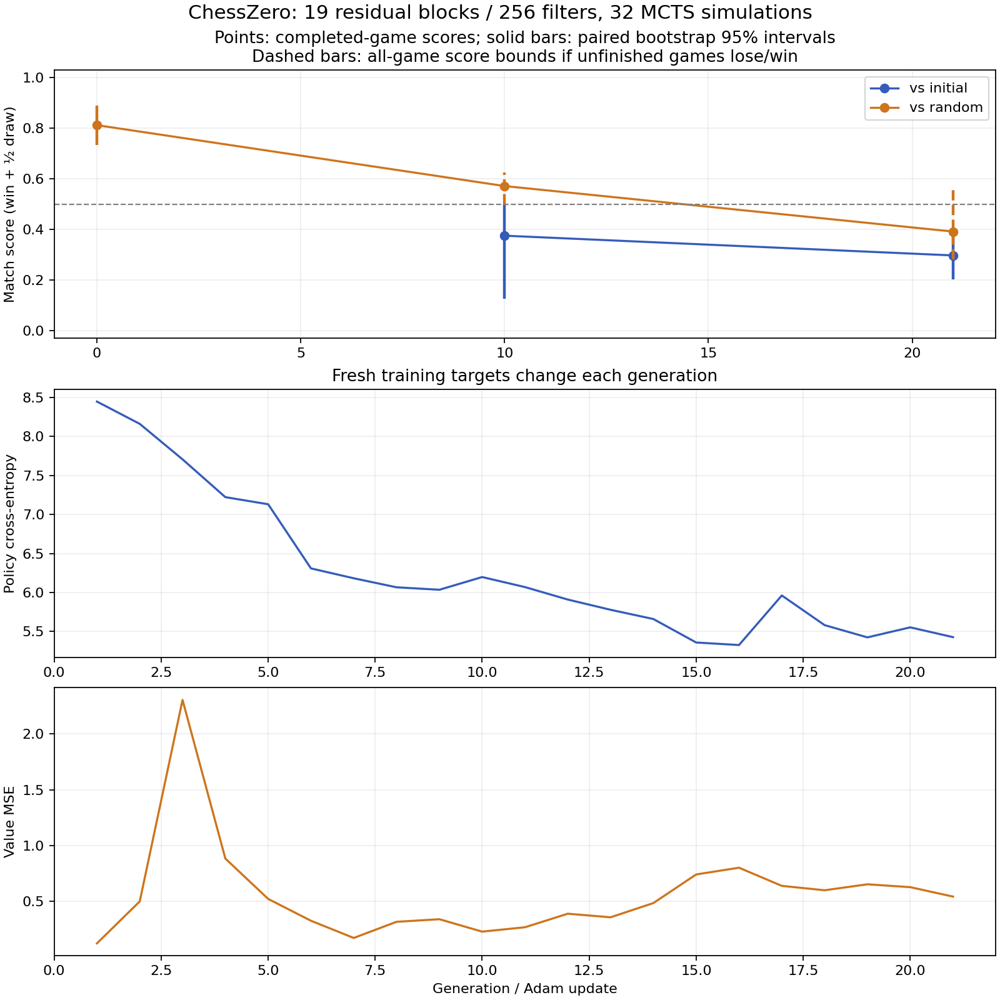

# Fresh-self-play learning experiment

Status: complete. **This run did not demonstrate convergence; the trained model
played worse than its starting checkpoint on the fixed evaluation bank.**

## Controlled follow-up: learning is verified

A subsequent [tiny forced-mate diagnostic](TACTICAL.md) **did converge on its
controlled task**, using the original model and fresh self-play. Both seeds
learned the mating move and correct values. A frozen-weight intervention also
identified BatchNorm running-statistics lag in that task. The short full-game
results below remain valid observations, but do not establish that learning is
broken or contradict the user's earlier longer-run convergence.

## Results

The original **19-block / 256-filter network (32,601,345 trainable parameters)**
completed 21 updates from 84 fresh self-play games / 26,301 positions in the
final checkpoint's lineage. Search used 32 simulations per move. The final
checkpoint was selected because it was the latest one persisted before a Modal
cancellation, not because of its score. The evaluation-only job completed with
exit code 0 and no timeout.

| Checkpoint / opponent | Wins | Draws | Losses | Unfinished | Completed-game score |
| --- | ---: | ---: | ---: | ---: | ---: |
| Initial / random | 21 | 10 | 1 | 0 | 81.25% |
| Generation 10 / random | 2 | 4 | 1 | 1 | 57.14% |
| Generation 21 / random | 2 | 14 | 7 | 9 | 39.13% |
| Generation 21 / frozen initial model | 0 | 19 | 13 | 0 | 29.69% |

Initial/final evaluation uses the same 16 opening pairs (32 games), with colors
swapped; generation 10 uses four pairs. Against random, even awarding all nine
unfinished final games a win gives **56.25%**, below the initial 81.25%. The
all-game score bounds are 28.125–56.25%; unfinished games are never counted as
draws. Against the initial model, the opening-pair bootstrap interval is
20.31–37.50%, an exploratory result on this bank rather than an Elo estimate.
The random-opponent bootstrap in the raw JSON uses only seven complete pairs;
use the all-game bounds when interpreting its nine censored games.

Policy cross-entropy averaged 6.946 over the first ten updates and 5.597 over the
last ten (19.4% lower), while value MSE stayed near 0.57–0.58. Lower training loss
did **not** translate into better play. All parameters remained finite and Adam
advanced exactly once per generation. Drawn games provided 54.9% of positions.
The retained training lineage spent 2,604.50 seconds generating self-play and
55.48 seconds learning; this excludes discarded updates, evaluation, queue time,
and interruptions and is not a fresh main-versus-integration speed comparison.



[Analysis](results/learning-final/analysis.json) ·
[Raw results](results/learning-final) ·
[Checkpoint verification](results/learning-final/checkpoint-verification.json).
All **112 evaluation games** (including censored histories) passed independent
move-by-move replay and completed-result checks. Native engine/MCTS generated
and chose every move; the chess library was only an oracle.

This short, single-seed experiment is negative evidence for this configuration,
not proof that the implementation cannot learn with a longer or differently
configured run. It does not justify spending days on the same setup as though
convergence were established. The next experiment should isolate learning-rate,
value/policy calibration and search-budget effects before scaling the workload.
Replay and random sampling were not introduced.

## Checkpoint and source

- Original training source: `50cbf8b230de8f16510fe45f1b18a7bf8b2556bb`.
- Continuation harness: `34d5370`, restoring generation 10 with Adam state and
  releasing unused allocator cache between phases.
- Final evaluation harness: `cc4566c`, restoring generation 21 with **no further
  training**. The production cache-release and legacy-loader cleanup committed
  afterwards do not change these recorded measurements.
- Modal volume: `chesszero-convergence`; final evaluation artifacts under
  `learning-full-final-eval-20261013-seed2026`; original generation-21 checkpoint
  under `learning-full-resume-20261013-seed2026/checkpoints`.
- Downloaded checkpoint: `/workspace/chesszero-learning-checkpoint`, containing
  `state_epoch_21.json` and its model/optimizer tensor files. It loads with Adam
  step 21, the original architecture, and finite parameters. Tensor files are
  not committed to Git.

## Original protocol and amendments


This experiment tests whether the integrated implementation improves with more
training. The previous three-update smoke test could not establish learning or
convergence. The protocol is fixed before inspecting the training results.

- Source: the full-model experiment commit on the draft integration branch; exact revision is recorded in `experiment.json`.
- One NVIDIA L4, eight CPU cores, 32 GiB RAM, maximum 100-minute workload (reserving the remainder of the original two-hour budget for diagnostics).
- The real ChessNet with 19 residual blocks / 256 filters, 4,672 policy outputs.
- Up to 100 generations of four complete fresh self-play games, four workers,
  32 MCTS simulations, microbatches of 64, Adam LR 0.001, model seed 2026.
- One position-weighted optimizer update per generation. No replay, shuffling,
  evaluation-game training, checkpoint rejection or tuning against evaluation.
- Training stops starting new generations after 75 minutes, reserving time for
  final evaluation. The outer 100-minute limit preserves completed results and
  never labels unfinished training games as draws.
- Production training workers retain their existing nondeterministic random
  initialization; the initial model seed alone does not make the run reproducible
  bit for bit.

## Evaluation

Generation zero plays 32 games against a seeded random legal-move strategy.
Checkpoints 10, 25 and 50 play eight games per opponent: the frozen initial model
and the same random strategy. Final evaluation plays 32 games per opponent.
The fixed opening bank is in `convergence.py`; each opening is played with the
candidate as White and Black. Intermediate evaluations use the first four
opening pairs; initial and final evaluations use all 16.

All neural opponents use the same search budget, evaluation mode, no root noise,
and temperature zero. Evaluation games never enter training. Games reaching the
512-ply evaluation limit are censored, not scored as draws. Reports include
completion counts and worst/best score bounds for censored games.

Scores award one point per win, half per draw, and zero per loss. Bootstrap
intervals resample opening pairs rather than treating the two colors as independent.
They describe variation across this small opening bank, not a calibrated Elo
estimate. A degenerate interval from identical pair scores is not proof of zero
uncertainty. Intermediate results are exploratory; the final checkpoint is chosen
by generation count or time limit, not by the best observed score.

The primary learning signal is improvement over the frozen initial model, with
the random-opponent score as a secondary check. Loss reduction alone is not
evidence of stronger chess. A short run showing improvement is still distinct
from convergence: the latter needs stable late-checkpoint performance and further
validation across seeds and opponents. The model is the original 19-block / 256-filter architecture; the search budget
is reduced to 32 simulations per move for this bounded experiment.

## Artifacts and reproduction

`modal_convergence.py` saves progress, evaluation move histories, initial/final
weights, and resumable model/Adam checkpoints in the Modal volume
`chesszero-convergence`, under the run ID. The downloaded result bundle excludes
tensor files; these remain in the volume. Checkpoints are saved every ten
generations and at the end.

Using the exported candidate setup from [README.md](README.md):

```sh
modal run --detach benchmarks/chesszero/modal_convergence.py \
  --run-id YOUR_UNIQUE_RUN_ID --output benchmark-results/learning
```

The function has a 100-minute child-process limit, commits partial results every
30 seconds, and shuts down its ephemeral GPU worker when finished. Progress is committed to the volume independently of the local log connection;
an explicit cancellation can still interrupt the workload. Four evaluator tests check legal
openings against an independent oracle, candidate-color scoring, paired scores,
and censoring. Production play still uses the repository's own chess engine.


## Preflight failure and correction

[Captured failing game and cache provenance](results/learning-preflight/invalid-cache-evidence.json).

The initial full-model baseline run was stopped before any completed training
update could be accepted. An independent replay found one illegal king move
among 32 evaluation games. A second instrumented run reproduced it: cached legal
moves allowed three king moves that a fresh calculation rejected. A provenance
probe then captured two different positions using the same integer cache key.

The cache PR #9 now retains exact position keys, allowing dictionary equality to
resolve hash collisions. The integrated key also retains en passant and repetition
history. A forced-collision regression protects both native move caching and MCTS
move caching; all 88 integrated tests pass on CPU. Evaluation now validates every
selected move and completed result online against a test-only oracle. The engine
and MCTS still generate and choose every move themselves.

The invalidated baseline score is not learning evidence. The current run starts
from scratch using source `50cbf8b`; the earlier speed comparisons also predate
this key correction and are not fresh performance measurements of this revision.

Additional verification after the key fix: 3,392 positions across ten complete
seeded games matched the independent oracle for legal moves, board states and
final outcomes (seed 7743, maximum 500 plies per game).

## GPU memory failure and continuation

The corrected run completed 19 generations / 76 games / 25,731 positions with
finite parameters and one Adam update per generation. Generation 20 failed with
`cudaMallocAsync ... out of memory` in a self-play worker. The existing worker
queue then waited indefinitely, so the stalled child process group was terminated
manually; `job.json` therefore records SIGTERM rather than an automatic timeout.
[Raw failed-run artifacts](results/learning-memory-failure/analysis.json) include
the worker traceback in `run.log`. All 48 recorded evaluation games passed replay.

At generation 10, the candidate scored 0 wins / 6 draws / 2 losses against the
frozen initial model (37.5%). Against random legal moves, it scored 2 wins /
4 draws / 1 loss, with one censored game (57.1% of completed games). The initial
model won all eight games on those same four opening pairs; across the full
initial 32-game bank it scored 81.25%. These early results show no improvement.

The continuation restores the full generation-10 model and Adam checkpoint.
Updates 11–19 from the failed attempt are not part of its lineage. The harness
now releases unused MLX allocator cache before self-play and evaluation, and saves
a resumable checkpoint after every update. It keeps four workers and four fresh
games per update; this is a memory-management change, not a change to training
targets or architecture. The new workload is limited to 40 minutes of training
and 50 minutes overall, keeping the combined attempt within the original bounded
experiment budget. This recovery protocol was selected after observing a resource
failure, not to select a better-scoring checkpoint.

The continuation saved generation 21 (84 games / 26,301 positions in its model
lineage) before Modal reported a cancellation signal at 14:23:21 UTC. Its log
contains no second CUDA OOM; the cancellation source is not identified. No
`completion.json` or `job.json` was produced. The latest saved checkpoint was
selected for a separate evaluation-only job, `learning-full-final-eval-20261013-seed2026`,
with zero additional training and a 15-minute limit. This evaluates 32 games per
opponent using the original fixed opening bank.

The phase-boundary allocator release is now also in PR #11's normal training
loop. Both the old MLX API fallback and legacy partial-Adam checkpoint loading
have been removed at the user's request. The project requires MLX >=0.32.3 and
the lockfile is updated. All 88 integrated tests pass on MLX 0.32.3 CPU; the
experiment uses the equivalent cache release in its harness.
