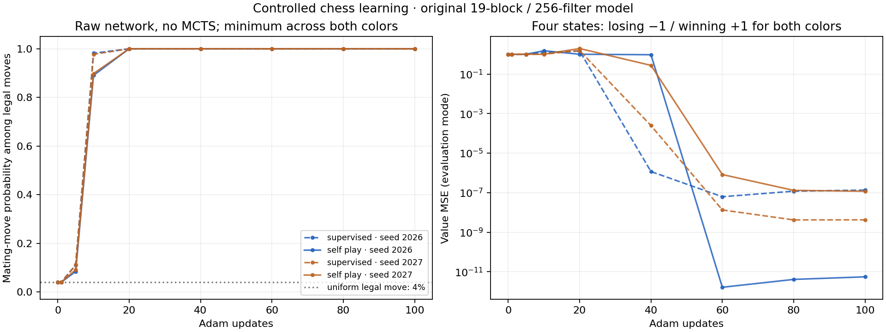

# Controlled chess learning: positive result

**The original model learns the simple forced-win task, including through fresh
self-play.** This diagnostic supports the user's point: the earlier 21-update
full-game run was insufficient to diagnose whether learning works, and does not
contradict their prior observation of convergence over days.

## Position and measurement

Start from `7k/8/5K2/6Q1/8/8/8/8 b - - 0 1`: White king f6, White queen g5,
Black king h8, Black to move. The verified line is **...Kh7 Qg7#**. Black has
one legal move; White then has exactly one mate-in-one among 25 legal moves.
A uniform legal-move policy finds that immediate finish with probability **4%**.
This is an immediate-mate criterion, not the chance of eventually winning a
queen-versus-king game. A color-swapped, rank-mirrored version checks both sides.

The central measurement is the **raw network in evaluation mode, without MCTS**:
mating-move probability/rank and side-to-move value on the losing root and winning
child of each version. Search already solves this ending before learning. Its
winning games alone would not establish that the network learned anything.

## Protocol

- Original 19 residual blocks / 256 filters / 32,601,345 trainable parameters.
- MLX 0.32.3 CUDA on one Modal NVIDIA L4; Adam learning rate 0.001.
- Two fresh initialization seeds, 2026 and 2027; 100 updates per test.
- Direct fitting is a separate positive control: four verified states, correct
  moves and values, one batch/update. It is not presented as self-play learning.
- Fresh-self-play test: two complete games/update from the fixture and its mirror;
  native MCTS generates all moves and policy visit counts, and native terminal
  outcomes supply value targets through the production `create_batches` and
  `Trainer.train_on_batches`. No correct move is injected into these targets.
- Search uses 64 simulations, temperature zero and no root noise, deliberately
  simplifying this diagnostic. One Adam update follows each four-position batch.
- No replay buffer or random sampling. Fresh games are generated each update,
  but the task deliberately repeats only four distinct states. This tests fitting
  a tiny task, not chess generalization.
- Probes run at updates 0, 1, 5, 10, 20, 40, 60, 80 and 100. Training-mode probes
  restore model/BatchNorm state afterwards; a test verifies their nonmutation.

## Results

| Test | Seed | Initial mate probability among legal moves | Final full-policy mate probability, worst color | First measured greedy mate, both colors | Final evaluation value MSE |
| --- | ---: | ---: | ---: | ---: | ---: |
| Direct fitting | 2026 | ~4% | 99.9967% | Update 1 | 1.35e-7 |
| Direct fitting | 2027 | ~4% | 99.9970% | Update 1 | 4.24e-9 |
| Fresh self-play | 2026 | ~4% | 99.9966% | Update 5 | 5.55e-12 |
| Fresh self-play | 2027 | ~4% | 99.9980% | Update 5 | 1.18e-7 |

Each self-play test generated **200 complete two-ply games / 400 training
positions**. All 400 games across the two seeds passed independent move-by-move
replay and outcome verification. All final model parameters were finite. The
self-play learning loops took 27.29 and 22.31 seconds respectively; the four-test
Modal workload finished successfully in 84.08 seconds, excluding allocation/build.
These timings describe this tiny task, not full-game training throughput.



[Raw measurements and move histories](results/tactical-learning/results.json) ·
[Verified summary](results/tactical-learning/summary.json).

## BatchNorm lag can hide learned values

In both fresh-self-play tests, the network preferred the mating move by update 5,
but evaluation-mode values remained inaccurate through update 20. Training-mode
values were already close to correct. Both evaluation-mode value errors fell
below 1e-6 by the update-60 measurement and remained small at updates 80 and 100.

A separate diagnostic trained seed 2026 for 20 updates, then froze the learned
parameters and optimizer. It ran 100 forward-only passes over the same four
states to refresh BatchNorm running statistics:

| Measurement | Before statistics refresh | After statistics refresh |
| --- | ---: | ---: |
| Evaluation-mode value MSE | 1.987506 | 6.70e-9 |
| Training-mode value MSE before refresh | 4.85e-9 | — |
| Adam step | 20 | 20 |
| Learned parameters | Identical before and after | Identical before and after |

The statistics-only intervention isolates the training/evaluation discrepancy
in this tiny task. It is diagnostic recalibration on the training fixture, not a
held-out result or a proposed universal production fix. Original statistics are
restored after measurement. This additional run's 40 complete games also passed
independent replay. The rerun is not bit-for-bit identical to the earlier seed's
trajectory; the causal comparison is within the same checkpoint, with unchanged
learned weights. [Raw BN intervention](results/tactical-bn/results.json).

This gives a concrete next investigation: measure and validate BatchNorm
calibration on representative full-game positions before interpreting early
checkpoint match results or committing to another long run. It does **not**
establish that BN alone caused the earlier full-game regression. More data and
more updates may well be needed for broad playing strength; this experiment does
not quantify how much or prove that any particular fix accelerates convergence.

## Reproduction and provenance

Use the export setup in [README.md](README.md), then:

```sh
modal run --detach benchmarks/chesszero/modal_tactical.py \
  --run-id YOUR_UNIQUE_ID --output benchmark-results/tactical
python benchmarks/chesszero/analyze_tactical.py benchmark-results/tactical
```

For the statistics-only check, add `--bn-check` and a new run ID; the wrapper
selects 20 self-play updates with seed 2026. Each workload has a 15-minute child
limit; no long training job is left running.

Main diagnostic source: `846f107`; BN diagnostic source: `f44b78f`. Full revisions
and configurations are recorded in each `experiment.json`. Modal volume
`chesszero-convergence` holds `tactical-20261013-two-seeds` and
`tactical-20261013-bn-check`. A runner import failure before either experiment
started was corrected; it produced no training measurements. These are benchmark
additions only: no production learning algorithm was changed for this follow-up.
